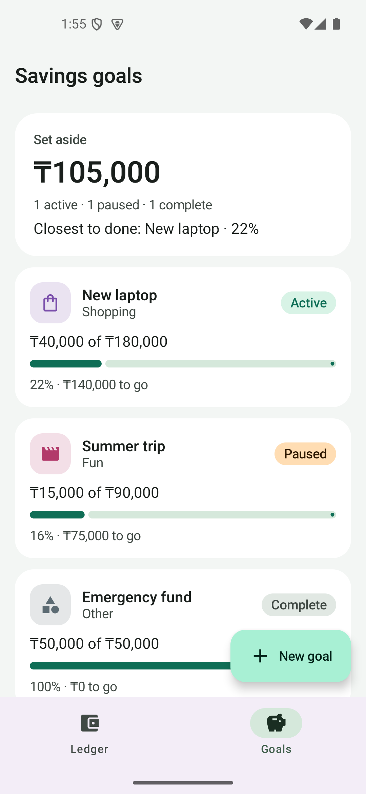
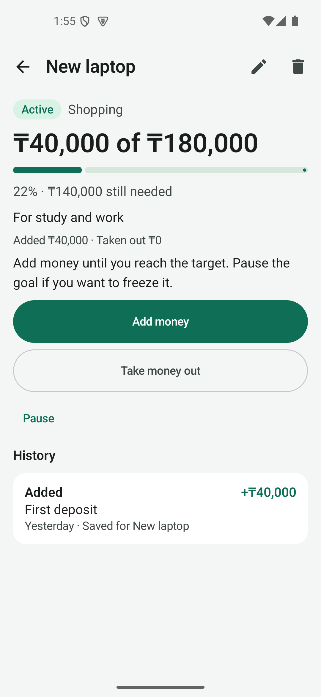
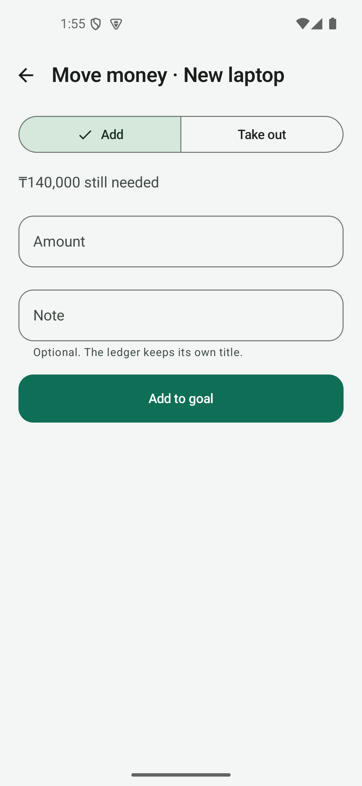
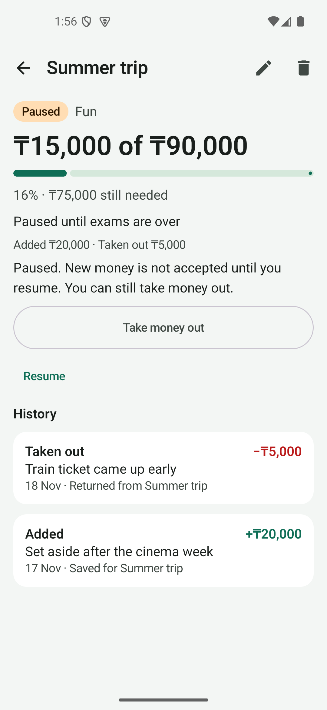

# Pocket Budget

Pocket Budget is a personal ledger for income, expenses, and savings goals. It extends the lab 2 expense tracker: the same summary, search, category filter, and tenge amounts now live in a Room database and stay in sync across screens.

The app uses Kotlin, Jetpack Compose, Material 3, Navigation Compose, and Room. UI state is exposed as `StateFlow` and collected with `collectAsStateWithLifecycle()`. Composables send user actions to a `ViewModel`. The `ViewModel` talks to a repository, and the repository is the only layer that reads and writes the database.

## Features kept from lab 2

- Summary card with balance, income, expenses, and a per-category breakdown.
- Scrollable transaction list. Each card shows a category icon, title, date, and amount.
- Add an income or expense. The form checks the title and the amount.
- Edit a transaction. Open it from the list, then tap the edit icon.
- Delete a transaction. A dialog asks first, and the following message offers Undo.
- Search by title, filter by category, and clear both. Totals follow the active filter.
- Categories: Food, Transport, Shopping, Bills, Fun, Salary, and Other.
- Amounts are shown in tenge (₸). The first launch inserts sample data.

## What this lab adds

**List and detail.** The ledger is a `LazyColumn` keyed by transaction id. Tapping a card opens a detail screen. Create and edit are their own screens, reached with Navigation Compose.

**Confirmation.** Delete always asks before it removes a transaction or a goal.

**Savings goals.** A goal has a name, a target, a category, a note, and a status: Active, Paused, or Complete.

- Add money only while the goal is active and still short of its target. The deposit cannot be larger than the amount still needed.
- Taking money out is allowed while the goal is active or paused, and only up to the amount already saved. A completed goal has to be reopened first.
- Pause freezes an active goal that is not yet funded. Resume brings it back. A funded goal is marked complete instead of paused.
- Mark complete only when the saved amount has reached the target.
- Raising the target of a completed goal makes it active again.
- Every deposit and withdrawal is also a ledger transaction, so the balance and the goal stay tied together. Renaming that ledger entry shows up in the goal history. Deleting it removes the matching goal entry too, and Undo puts both back.
- Deleting a goal that still holds money asks to release that money back to the balance first. The release is an income transaction.
- The goals screen shows how much is set aside, how many goals are active, paused, and complete, and which open goal is closest to its target. Each goal has a progress bar and a history list keyed by contribution id.
- The ledger summary shows the total set aside when no filter is active.

Changes on one screen show up on the others because every screen collects a Room `Flow`. Data is still there after the app is closed and opened again. Search text and an in-progress form survive rotation.

## Screenshots

The sample goals are New laptop (active), Summer trip (paused), and Emergency fund (complete). Together they hold ₸105,000.

<table>
  <tr>
    <td valign="top" width="300">
      
    </td>
    <td valign="top">
      <h3>Goals and progress</h3>
      <p>The <strong>Goals</strong> tab opens the savings list. The card at the top shows <strong>₸105,000</strong> set aside, the count of each status, and the open goal closest to its target. Each row is a goal card with a category icon, a status badge, saved amount against the target, and a progress bar. <strong>New goal</strong> starts a blank goal.</p>
    </td>
  </tr>
  <tr>
    <td valign="top" width="300">
      
    </td>
    <td valign="top">
      <h3>Active goal</h3>
      <p>New laptop is active and 22% funded: <strong>₸40,000 of ₸180,000</strong>, with ₸140,000 still needed. While it is active and short of the target, the screen offers <strong>Add money</strong>, <strong>Take money out</strong>, and <strong>Pause</strong>. History lists the first deposit and the ledger title it created, <em>Saved for New laptop</em>.</p>
    </td>
  </tr>
  <tr>
    <td valign="top" width="300">
      
    </td>
    <td valign="top">
      <h3>Move money</h3>
      <p><strong>Add money</strong> opens the move screen for that goal. <strong>Add</strong> and <strong>Take out</strong> switch the direction. The line under the switch shows how much is still needed, here ₸140,000, so a deposit larger than that is rejected. The note is optional. <strong>Add to goal</strong> writes the contribution and a matching ledger transaction.</p>
    </td>
  </tr>
  <tr>
    <td valign="top" width="300">
      
    </td>
    <td valign="top">
      <h3>Paused goal and history</h3>
      <p>Summer trip is paused at <strong>₸15,000 of ₸90,000</strong>. The hint says new money is not accepted until the goal is resumed, and <strong>Take money out</strong> stays available. History shows both directions: ₸5,000 taken out for a train ticket, and ₸20,000 added earlier. <strong>Resume</strong> returns the goal to active.</p>
    </td>
  </tr>
</table>

## Layout

- `data/local` — Room entities, DAOs, converters, and the database
- `data/repository` — `BudgetRepository` and the Room implementation
- `domain` — balance math, validation, and the goal status rules
- `ui` — screens, ViewModels, and reusable composables

## Requirements

- Android Studio with Android SDK 37
- JDK 17 or newer (Android Studio’s bundled JDK is enough)
- A device or emulator running Android 8.0 (API 26) or newer

## Run in Android Studio

1. Open Android Studio and choose **Open**.
2. Select this project folder (`lab_03`).
3. Wait for Gradle to sync.
4. Start an emulator, or connect a device with USB debugging enabled.
5. Select the **app** run configuration and press **Run**.

Unit tests:

```
./gradlew :app:testDebugUnitTest
```
